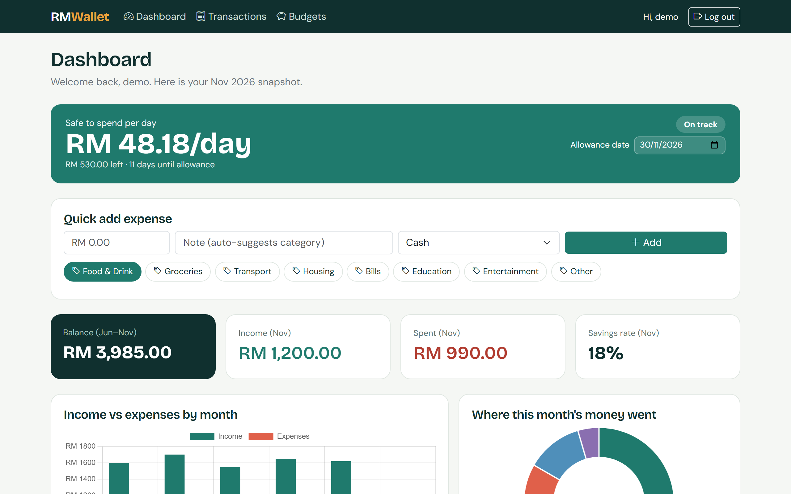
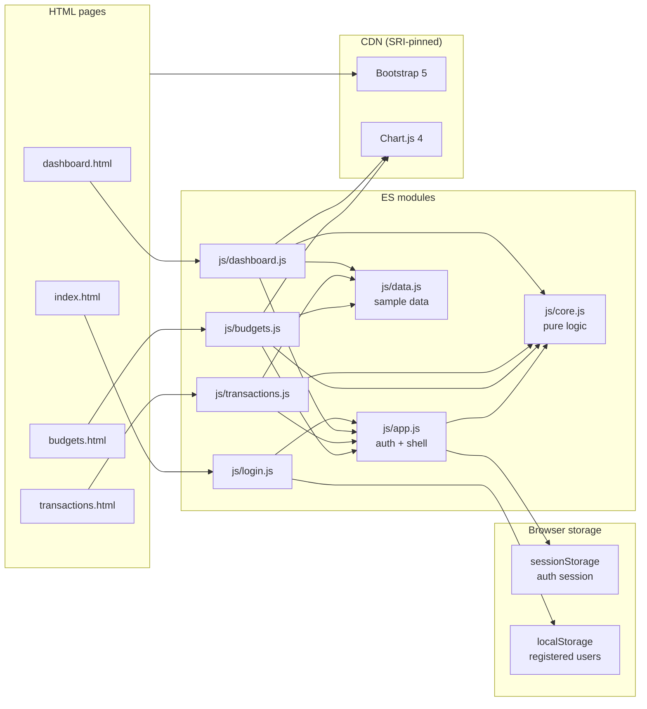

# RM Wallet

**Know where your allowance goes — one ringgit at a time.** RM Wallet is a fast, dependency-free personal finance tracker for students: track income, spending and monthly budgets in Malaysian Ringgit, with charts that make your money obvious in seconds.

[](https://github.com/ammarrrrrshikiiiii/rm-wallet/actions/workflows/ci.yml)
[](LICENSE)
[](https://github.com/ammarrrrrshikiiiii/rm-wallet/releases)



## Why RM Wallet

A student's money is a small number of ringgit moving between a handful of buckets — allowance in, food, rent and transport out. You don't need a spreadsheet or a banking app to understand it; you need a clear answer to one question: *where did it go?* RM Wallet answers that question with a clean dashboard, a searchable transaction log and per-category budgets that turn red the moment you go over.

- ⚡ **Zero dependencies, zero build.** It's plain HTML, CSS and ES modules. Nothing to install or compile.
- 📊 **Charts that mean something.** Income vs expenses by month, spending by category, budget vs actual.
- 💸 **Budgets that warn you.** Progress bars go amber at 80% and red past 100%.
- 🔒 **Hardened by default.** Content-Security-Policy, Subresource Integrity, and XSS-safe rendering.
- 🧪 **Actually tested.** A unit-test suite and static-integrity checks that run in CI.

## Quickstart

You only need [Bun](https://bun.sh) (≥ 1.0).

```bash
# 1. Start the dev server (serves the static site at http://localhost:8080)
bun start

# 2. Open the printed URL in your browser
#    http://localhost:8080

# 3. Click "Use demo account", then "Sign in"
```

That's it — you're looking at the dashboard in under a minute.

> **No Bun?** Serve the folder with any static server: `npx serve .` or `python -m http.server 8080`. Everything runs client-side, so any static host (including GitHub Pages) works.

### Demo credentials

| Username | Password       |
| -------- | -------------- |
| `demo`   | `Finance@123`  |

You can also register a new account — it's stored in your browser's `localStorage`. **This is simulated, client-side auth for demonstration only** (see [SECURITY.md](SECURITY.md)).

## Features

- **Login / register** with a demo account, validation, and a one-click "Use demo account" shortcut.
- **Dashboard** — balance, latest-month income/spend/savings rate, income-vs-expense bar chart, spending doughnut, and the five most recent transactions.
- **Transactions** — search and filter by type and category, newest first.
- **Budgets** — per-category progress cards, a budget-vs-actual chart, and a table showing what's left (or how far over you are).
- **Responsive & accessible** — works on mobile, with `aria-live` status, labelled charts, `scope` on table headers, and WCAG-AA colour contrast.
- **Security basics** — CSP, SRI-pinned CDN assets, HTML output escaping (stored-XSS fix), no inline scripts, and a traversal-guarded dev server.

## Commands

| Command           | What it does                                        |
| ----------------- | --------------------------------------------------- |
| `bun start`       | Start the zero-dependency dev server on `:8080`     |
| `bun test`        | Run the unit tests (`bun test`)                     |
| `bun run check`   | Verify assets, SRI, CSP, and that core logic is DOM-free |
| `bun run screenshot` | Regenerate the README screenshots (needs Playwright) |

Or via `make`: `make start`, `make test`, `make check`.

## Project structure

```
.
├── index.html            login / register
├── dashboard.html        overview with charts
├── transactions.html     searchable, filterable log
├── budgets.html          limits vs actual spending
├── css/style.css         global styles
├── js/
│   ├── core.js           pure domain logic (unit-tested, DOM-free)
│   ├── data.js           sample data (Jun–Nov 2026)
│   ├── app.js            auth guard + navbar/footer shell
│   └── *.js              one module per page
├── test/                 bun test suites
├── scripts/              check.mjs, screenshot.mjs
├── docs/                 architecture, ADRs, roadmap, screenshots
├── serve.js              zero-dependency static dev server
├── .github/              CI + Dependabot + issue/PR templates
└── Makefile              convenience targets
```

## Architecture



Data flows one way: static sample data (`js/data.js`) → pure functions (`js/core.js`) → page modules render escaped HTML. There is no server state; see the [ADRs](docs/adr) for the reasoning behind each key decision.

## Testing & CI

- **Unit tests** (`bun test`) cover the currency formatter, totals, month helpers, budget math, filtering, savings rate and HTML escaping.
- **Integrity checks** (`bun run check`) verify that every local asset resolves, no inline scripts remain, all CDN assets carry SRI, and the core modules stay DOM-free.
- **GitHub Actions** runs both on every push and pull request; **Dependabot** keeps Actions and the dev dependency current.

## Deploying to GitHub Pages

1. Push this repository to GitHub.
2. Go to **Settings → Pages**, set *Source* to **Deploy from a branch**, choose `main` and `/ (root)`, then save.
3. Your site is live at `https://ammarrrrrshikiiiii.github.io/rm-wallet/`.

## Roadmap

See [docs/roadmap.md](docs/roadmap.md) — short term: transactions CRUD with `localStorage` persistence and CSV export; medium term: a real backend with authentication; long term: PWA/offline support.

## Contributing & license

Contributions are welcome — read [CONTRIBUTING.md](CONTRIBUTING.md) and the [Code of Conduct](CODE_OF_CONDUCT.md). RM Wallet is MIT licensed; see [LICENSE](LICENSE).

Built with ❤️ for students, one ringgit at a time.
