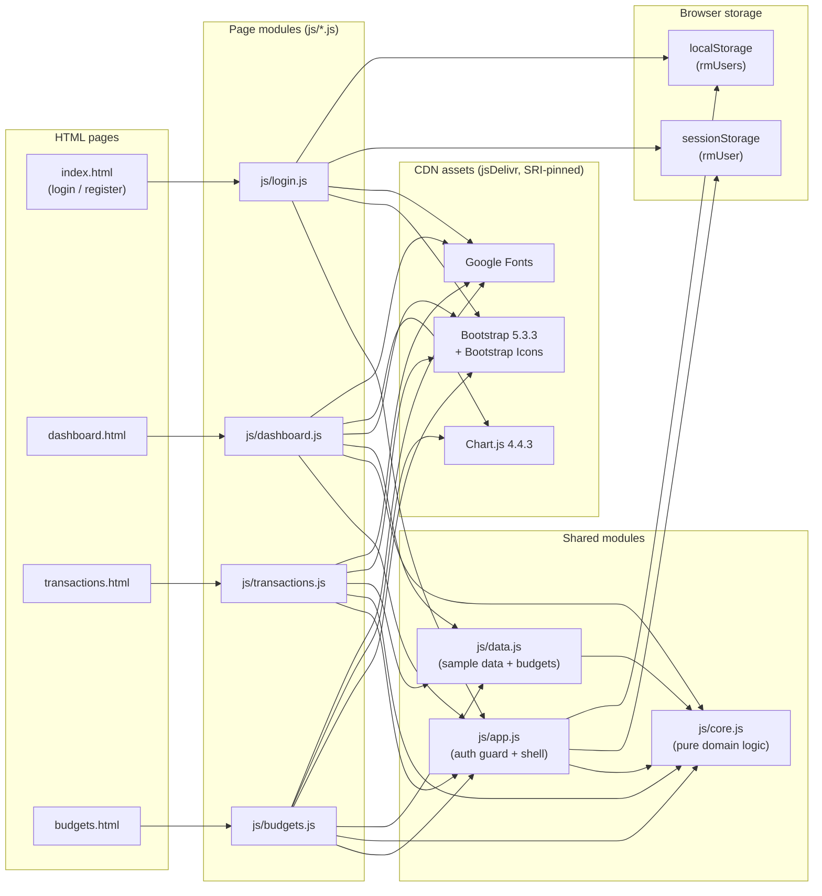

# RM Wallet — Architecture Overview

## System summary

RM Wallet is a personal expense tracker for students, working in Malaysian Ringgit (RM). It helps a student track spending, set a monthly budget and per-category limits, and see how much budget remains.

The application is a **static web app**: there is no build step, no backend server, and no database. The site is plain HTML, CSS, and vanilla JavaScript ES modules served directly to the browser, so it can be hosted on any static host (for example GitHub Pages). All interactivity runs client-side; the "database" is static sample data in code, and any user-specific state lives in browser storage.

- **Stack:** vanilla JavaScript (ES modules), Bootstrap 5.3.3, Bootstrap Icons 1.11.3, Chart.js 4.4.3 (all via jsDelivr CDN, pinned with Subresource Integrity), and Google Fonts.
- **Runtime dependencies:** zero npm runtime dependencies. Bun (>= 1.0) is required only for the local dev server, tests, and integrity checks.
- **Pages:** `index.html` (login/register), `dashboard.html`, `transactions.html`, `budgets.html`.

## Structure

```
rm-wallet/
├── index.html           # Login / register
├── dashboard.html       # Summary + charts
├── transactions.html    # Transaction list with search/filter
├── budgets.html         # Monthly budget vs. spending
├── js/
│   ├── core.js          # Pure domain logic (no DOM)
│   ├── data.js          # Static sample transactions + budgets
│   ├── app.js           # Auth guard + navbar/footer shell
│   ├── login.js         # Login/register page module
│   ├── dashboard.js     # Dashboard page module
│   ├── transactions.js  # Transactions page module
│   └── budgets.js       # Budgets page module
├── css/style.css
├── assets/favicon.svg
├── serve.js             # Zero-dependency Bun static server
├── scripts/check.mjs    # Static-site integrity checks
└── test/*.test.js       # bun test unit tests
```

## Component diagram



Each HTML page loads exactly one ES module entry point (`js/login.js`, `js/dashboard.js`, `js/transactions.js`, or `js/budgets.js`). Those page modules import shared modules: `js/app.js` (auth guard and the navbar/footer shell), `js/core.js` (pure, DOM-free domain logic), and `js/data.js` (the static sample data). CDN assets are loaded in the HTML with pinned Subresource Integrity, and the browser's `sessionStorage` / `localStorage` hold the simulated session and registered users.

## Data flow

The application is a simple one-way data flow with no mutable shared state:

1. **Static sample data** — `js/data.js` exports a fixed `TRANSACTIONS` array (expense records only) and a `BUDGETS` array (per-category monthly limits). This module simulates a database and is also DOM-free so it can be unit-tested.
2. **Pure functions** — `js/core.js` contains all domain logic as pure functions: the `rm()` currency formatter, `totalExpenses()`, `monthName()`, `deriveCurrentMonth()`, `monthsIn()`, `spentInMonth()`, `computeBudgets()`, `filterTransactions()`, `latestTransactions()`, and `escapeHtml()`. These take data in and return new values; they never touch the DOM.
3. **Render** — page modules (`dashboard.js`, `transactions.js`, `budgets.js`) call the pure functions and update the DOM. Before any user-supplied string is injected into `innerHTML`, it is passed through `escapeHtml()` to prevent XSS. `app.js` renders the shared navbar and footer via the same escaping discipline.

In short: `js/data.js → js/core.js (pure functions) → page modules render escaped DOM`. Authentication state is read/written directly against `sessionStorage` (`rmUser`) and `localStorage` (`rmUsers`) by `login.js` and `app.js`.

## Security & integrity

- **Content-Security-Policy (CSP)** — each page sets a `<meta http-equiv="Content-Security-Policy">` that restricts `default-src` to `'self'`, allows scripts only from `'self'` and `https://cdn.jsdelivr.net`, allows styles from `'self'`, jsDelivr, and Google Fonts (with `'unsafe-inline'` for inline styles), and pins `font-src`, `img-src`, `connect-src`, `base-uri`, and `form-action`. This limits what code can run and where assets may load from.
- **Subresource Integrity (SRI)** — every CDN asset (Bootstrap CSS, Bootstrap Icons CSS, Chart.js, and the Bootstrap JS bundle) is loaded with an `integrity` and `crossorigin` attribute so the browser verifies the fetched file against a pinned hash. Google Fonts stylesheets are the documented exception: they are dynamic and cannot carry SRI.
- **Output escaping** — `escapeHtml()` is applied before any string is inserted into `innerHTML`. Messages and labels use `textContent` where possible, and the integrity check enforces that all scripts are external modules (no inline scripts).
- **Security headers (dev server)** — `serve.js` sets `X-Content-Type-Options: nosniff`, `X-Frame-Options: DENY`, and `Referrer-Policy: no-referrer`, and blocks path traversal outside the project root.
- **Client-side-only auth caveat** — authentication is **simulated** and is **not real security**. Credentials are checked in the browser, and registered users (username/password) are stored in plaintext in `localStorage`. Anyone can bypass the login screen or read stored values. See ADR-0003.

## Testing & CI

- **Unit tests** — `bun test` runs `test/core.test.js` and `test/data.test.js`, which cover the pure logic in `core.js` and the shape of the sample data in `data.js`. Because `core.js` and `data.js` are DOM-free, they run identically in Node/Bun and in the browser.
- **Integrity checks** — `bun run check` runs `scripts/check.mjs`, which acts as the "build" for a no-build app. It verifies local asset references resolve, there are no inline scripts, external CDN assets are pinned with SRI, required document basics are present, and `js/core.js` / `js/data.js` remain free of DOM APIs.
- **CI** — `.github/workflows/ci.yml` runs on push to `main` and on pull requests, using `oven-sh/setup-bun@v2`, then executes `bun run check` and `bun test`. No `bun install` is needed because there are zero npm runtime dependencies.

## Running locally

- `bun start` (or `bun serve.js`) — start the zero-dependency dev server on port `8080` (override with `PORT`).
- `bun test` — run the unit tests.
- `bun run check` — run the static-site integrity checks.
